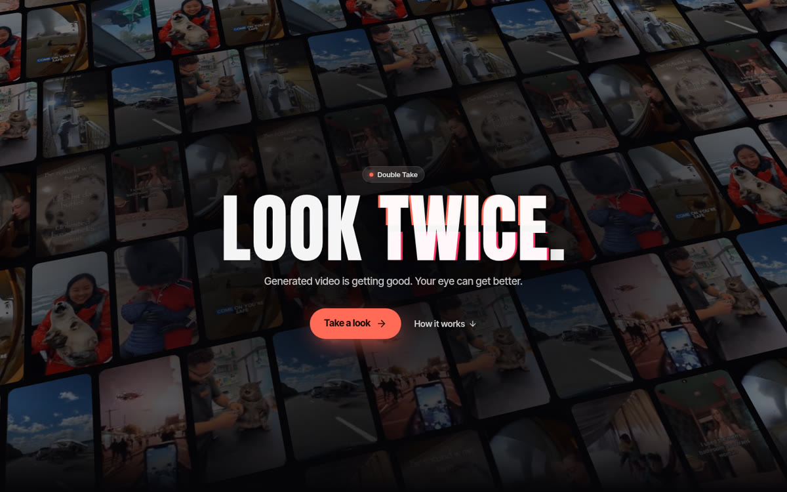
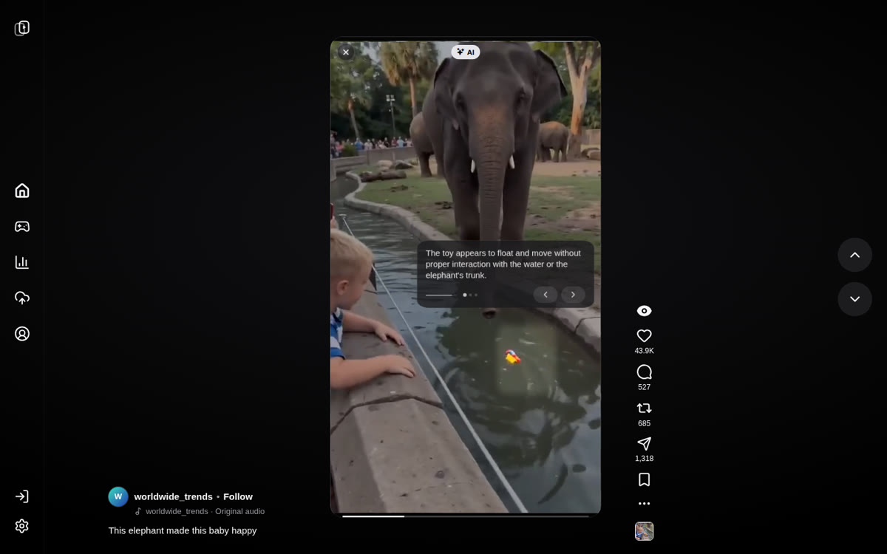
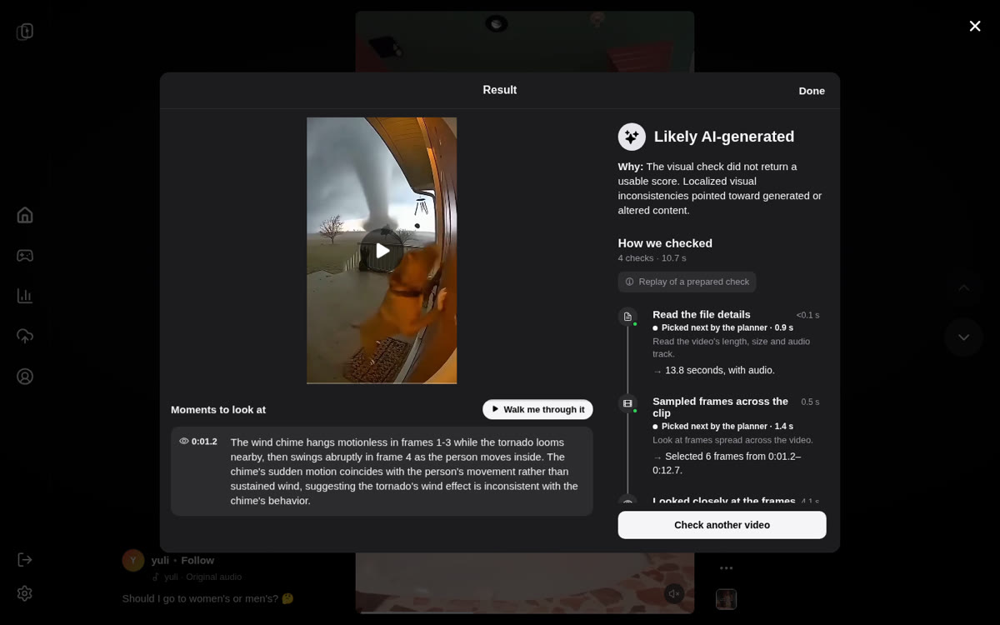
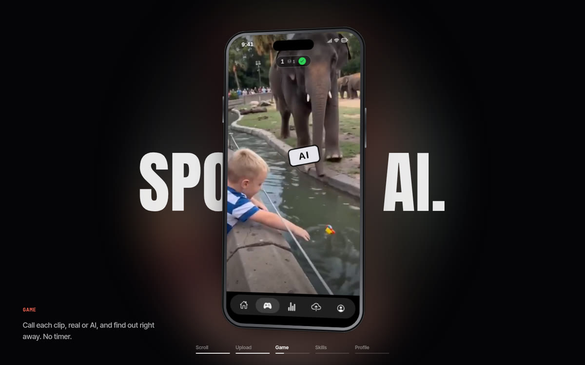
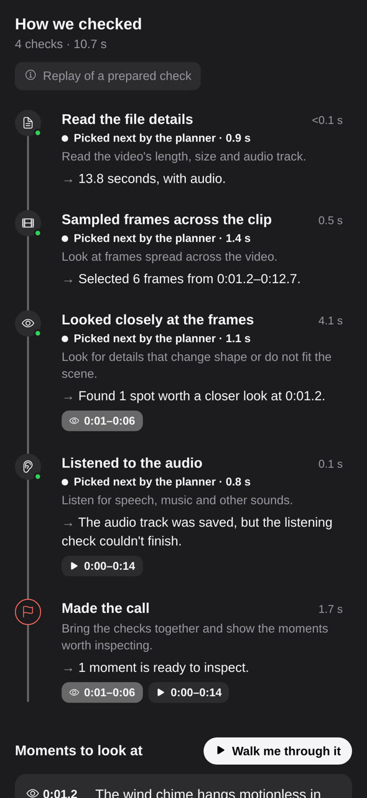
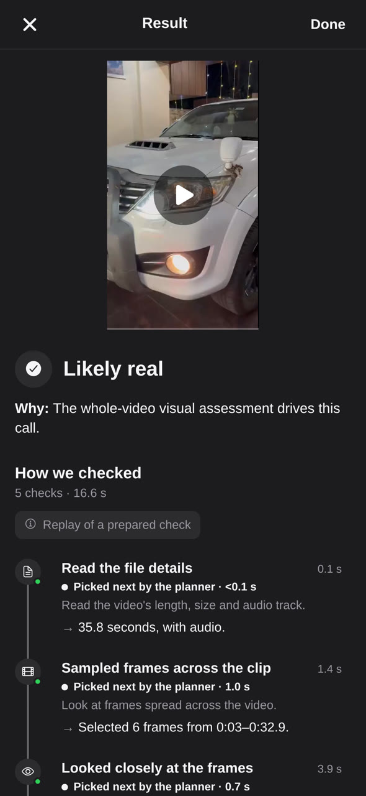
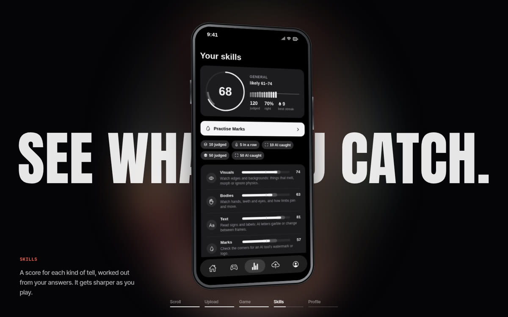

# DoubleTake

A short-video app that trains you to spot AI video, built in 24 hours at **HackUTD 2026: ZeroDay**.

Scroll a feed of real and generated clips, call each one, and step through the moments that
give it away. Give it your own clip or link, and an agent built on NVIDIA Nemotron checks it
and shows how it checked.

**[Live site](https://double-take-app.fuzzywuzzygordon.workers.dev)** · **[Demo video](TODO)** · **[Devpost](TODO)**

| Landing | Double take |
| --- | --- |
|  |  |
| **Check a video** | **Game** |
|  |  |
| **How we checked** | **Likely real** |
|  |  |
| **Skills** | |
|  | |

## Features

- **Scroll and the double take**: a full-screen feed of short clips. Hold or double tap any
  clip to open its walkthrough: a spotlight and a card step through each tell while the
  video scrubs between moments in slow motion.
- **Upload and check**: drop in a video or paste a link. The investigator returns a verdict,
  the moments to look at, and **How we checked**: each step it took, the model behind it and
  what it found, shown live as it runs.
- **Game**: an untimed "spot the AI" round. Double tap or hold to mark a clip AI, swipe on if
  it's real, and get the answer at once. Looking back at a marked clip opens its walkthrough.
- **Skills**: a general score (50 is guessing) with its likely range, recent trend and
  streaks, plus a score and a tip per kind of tell (visuals, bodies, text, marks, real
  footage), and a button to practise your weakest.
- **Accounts**: watch without signing in. Likes, reposts, saves, follows and comments ask you
  to sign in, create an account (username and password, no email) or continue as a guest.
- **Landing (web)**: a wall of clips that hands off into the app, and a scroll-through tour
  of the features on a pinned phone.

## How it works

| Part | What it does |
| --- | --- |
| **App** (`src/`) | Expo (React Native) for iPhone, iPad and the web. |
| **Feed Worker** (`worker/`) | Cloudflare Worker serving the feed and its media through signed URLs. |
| **Supabase** (`supabase/`) | Accounts, likes/saves/follows/comments with row level security, cloud settings and prepared demo checks. |
| **Job runner** (`scripts/jobs/`) | Takes uploads, makes playable copies, and runs the investigator as its analyzer module. |
| **Investigator** | An agent: a Nemotron planner picks each next tool; Nemotron 3.5 Super VL reads frames, Nemotron 3 Nano Omni watches video with audio, and a locally fine-tuned Cosmos Reason 2 gives a second read on the video. Its trace becomes How we checked. |
| **Tells pipeline** (`scripts/annotate/`) | Drafts each feed clip's walkthrough from its Community Note with Nemotron, then checks the boxes with pixel and scene-cut checks. |

Limits: the investigator is a prototype. On hard clips it's often unsure and sometimes wrong,
so it shows its evidence and says when it isn't sure rather than claiming certainty.

## Tech stack

Expo 58 · React Native · React 19 · TypeScript · Expo Router · Reanimated · expo-video ·
Cloudflare Workers · Supabase · NVIDIA Nemotron · Cosmos Reason 2 · Node.js

## Run locally

Requires Node.js 24+, [Expo Go](https://expo.dev/go) on a phone, and `ffmpeg` for the job runner.

```bash
npm ci
# .env.local (all optional; without them the app runs on placeholder clips)
EXPO_PUBLIC_API_URL=...                   # feed Worker
EXPO_PUBLIC_DEMO_PASSCODE=...
EXPO_PUBLIC_SUPABASE_URL=...              # accounts
EXPO_PUBLIC_SUPABASE_PUBLISHABLE_KEY=...
EXPO_PUBLIC_JOBS_URL=...                  # checks (the job runner)
npx expo start                            # scan the QR code with Expo Go; press w for the web
npm run check                             # typecheck, lint, tests
```

- **Feed Worker:** `npm --prefix worker run dev` (see [worker/README.md](worker/README.md)).
- **Job runner:** `node scripts/jobs/server.ts` (see [docs/upload-jobs.md](docs/upload-jobs.md)).
- **Host the web app:** `npm run deploy:web` (see [docs/development.md](docs/development.md)).

## More docs

- [Development](docs/development.md): devices, Tailscale, checks, env files, hosting
- [Feed and desktop web](docs/feed.md): playback, gestures, source map
- [Landing page](docs/landing.md): the launch, the gallery atlas, design knobs
- [Accounts](docs/accounts.md): sign-in, guests, Supabase setup, security notes
- [Tells pipeline](docs/tells-pipeline.md): drafting, checking and comparing walkthroughs
- [Upload job runner](docs/upload-jobs.md): the runner and its analyzer interface

## Team

Built solo by **Kenny Quach** ([@kennnyq](https://github.com/kennnyq)).
